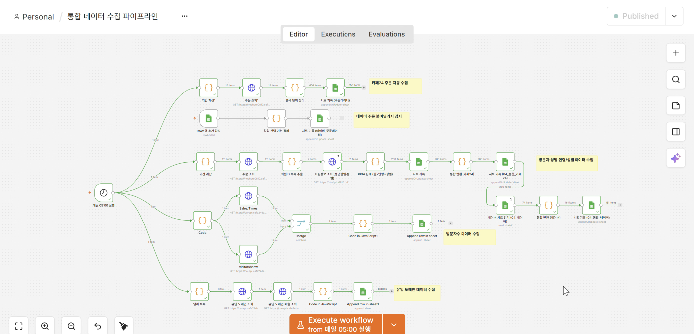

# 카페24·네이버 판매 데이터 통합 파이프라인

카페24 자사몰과 네이버 스마트스토어의 판매 현황을 한 화면에서 확인할 수 있도록, 4인 팀이 데이터 수집부터 대시보드 구축까지 진행했습니다.
저는 두 채널의 주문 데이터를 정리하고 상품·고객 지표를 집계하는 n8n 파이프라인 설계를 맡았습니다.

| 항목 | 내용 |
| --- | --- |
| 수행 기간 | 2026.06.29–2026.08.23 · 8주 |
| 프로그램 | 미래내일 일경험 지원사업 프로젝트형 |
| 팀 / 작성자 | 오지데이터(4인) / 박비원(Park Bi Won) |
| 담당 역할 | 채널별 수집 흐름 설계, 상품명 표준화, Google Sheets 적재 및 BI 연동 |
| 사용 기술 | n8n Cloud, JavaScript, HTTP API, OAuth 2.0, Google Sheets, Data Studio(구 Looker Studio) |

## 프로젝트 배경

담당자는 판매 현황을 확인할 때마다 두 채널에서 파일을 내려받아 정리해야 했습니다. 같은 상품도 채널에 따라 상품명과 옵션 표기가 달랐고, 고객 리포트에서 제공하는 지표도 달랐습니다.

기업에는 데이터 시스템을 전담하는 인력이 없었습니다. 카페24 주문은 API로 수집하고, 네이버 주문은 담당자가 기존 방식대로 내려받은 파일을 지정 시트에 붙여 넣으면 이후 정제가 자동으로 진행되도록 구성했습니다. 팀원 및 기업 담당자와 함께 특이 거래의 포함 기준을 정하고, 대시보드를 검수한 뒤 사용 방법을 인계했습니다.

## 수집 흐름

- 카페24는 정기 실행을 시작점으로 주문, 고객, 방문·매출, 유입경로 데이터를 처리합니다.
- 네이버 주문은 별도의 Google Sheets 트리거가 새 행을 감지하면 처리를 시작합니다.

| 데이터 | 조회·실행 기준 | 저장 방식 |
| --- | --- | --- |
| 카페24 품목별 주문 | 정기 실행 시 최근 7일 조회. 수동 실행 시 2025년 6월부터 월 단위로 조회 | 품목별 주문번호가 같으면 갱신, 없으면 추가 |
| 네이버 품목별 주문 | 주문 시트에 새 행이 추가됐는지 1분 간격으로 확인 | 상품주문번호가 같으면 갱신, 없으면 추가 |
| 카페24 월별 고객 집계 | 정기 실행 시 지난달과 이번 달 재집계. 수동 실행 시 2025년 1월부터 월 단위로 조회 | 월·성별·연령대 기준으로 갱신·추가 |
| 일별 방문·매출 | 전일 데이터 조회 | 새 행 추가 |
| 유입 도메인별 방문·매출 | 전일 데이터 조회 | 새 행 추가 |

## 주요 데이터 처리 기준

### 1. 채널별 상품명을 품목 단위로 정리했습니다

카페24 주문 한 건에 여러 상품이 포함될 수 있어 주문을 품목별 행으로 나눴습니다. 상품명만으로 구분하기 어려운 경우에는 옵션에서 제품명과 세트 구성을 추출했습니다. 예를 들어 ‘버터오징어’가 일반 ‘오징어’로 분류되지 않도록 ‘버터오징어’를 먼저 검사해 두 상품이 같은 이름으로 묶이지 않도록 했습니다. 네이버 주문에는 해당 채널의 옵션 표기에 맞춘 정제 규칙을 적용했습니다.

### 2. 구매자 수와 주문 수를 구분했습니다

카페24 주문에서 중복을 제거한 회원 ID를 100개씩 묶어 회원정보를 조회한 뒤, 주문과 결합했습니다. 같은 회원이 한 달에 두 번 주문하면 해당 집단의 구매자는 1명, 주문은 2건으로 집계합니다.

월별 결과에는 남녀 각 6개 연령대와 성별·연령을 확인할 수 없는 집단을 포함해 총 13개 조합을 생성했습니다. 구매가 없었던 집단도 0으로 표시해 월별 비교에서 빠지지 않도록 했습니다.

### 3. ‘0건’과 ‘제공되지 않는 지표’를 구분했습니다

두 채널의 고객 데이터를 월·채널·성별·연령대 단위로 정리했습니다. 카페24의 성별·연령대별 고객 집계에는 방문자 수가 없고, 네이버 고객 리포트에는 주문 수가 없어 각각 공란으로 남겼습니다. 제공되지 않는 값을 0으로 표시하면 실제로 방문이나 주문이 없었다는 뜻으로 읽힐 수 있기 때문입니다.

## 결과 및 상세 자료

팀은 7개 KPI를 5개 대시보드 페이지로 구성하고, 사용 가이드와 함께 기업 담당자에게 인계했습니다.
이 저장소에는 운영 식별정보를 제거한 n8n 워크플로와 데이터 처리 코드를 공개합니다. 실제 고객·주문 데이터와 최종 대시보드 화면은 공개 범위에서 제외했습니다.

- [프로젝트 수행 과정과 개인 역할](docs/01-case-study.md)
- [데이터 처리 기준과 코드](docs/03-data-processing.md)
- [공개용 n8n 워크플로 JSON](workflows/main.sanitized.json)
